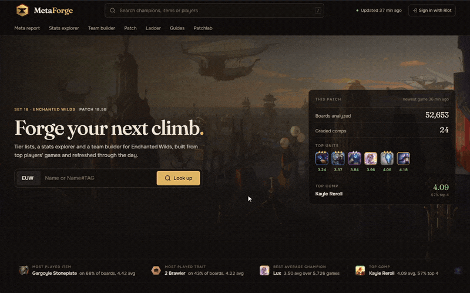
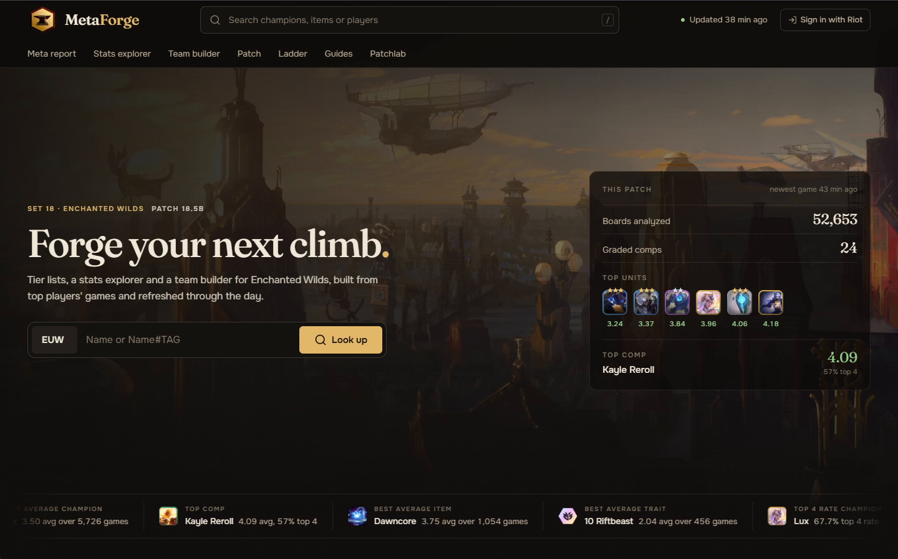
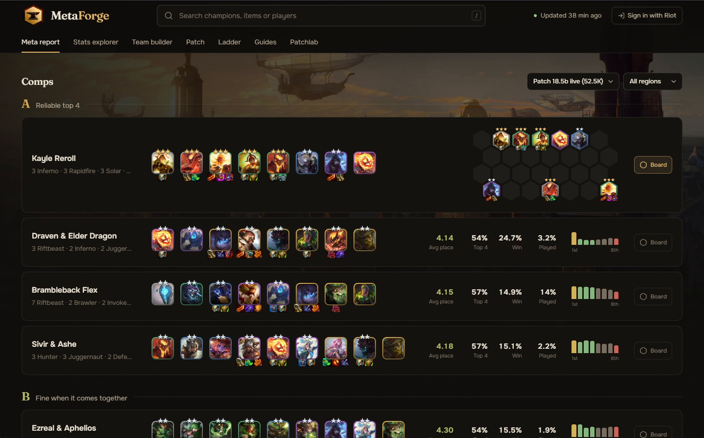
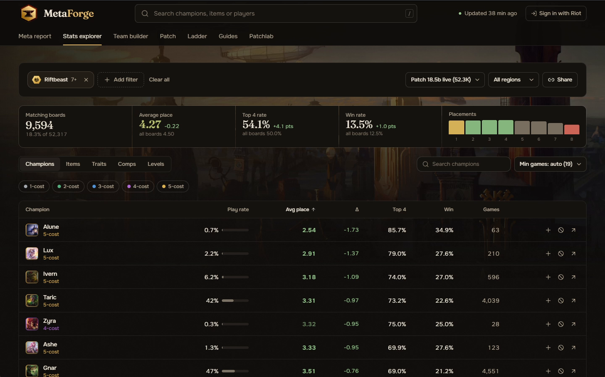
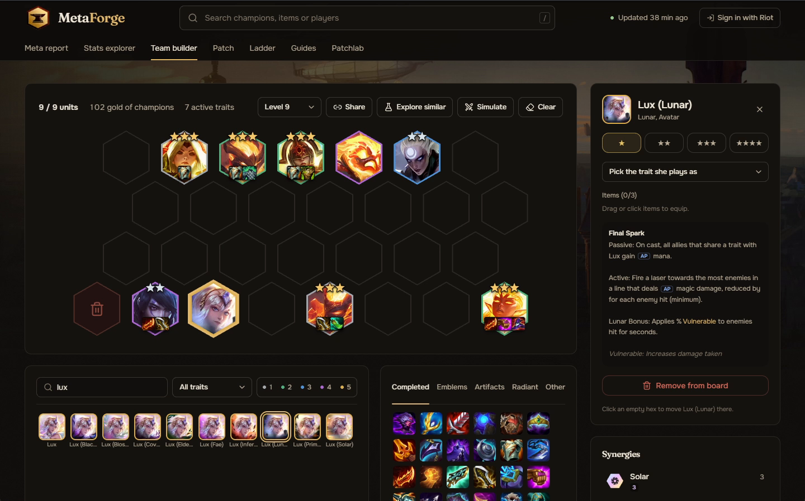

<h1 align="center">MetaForge</h1>

<p align="center">Tools for Tacticians</p>

<p align="center"><b><a href="https://www.metaforge.lol">metaforge.lol</a></b> · <a href="https://www.gimzdev.com/work/metaforge?utm_source=github">Case study</a></p>

<p align="center"></p>

MetaForge grades Teamfight Tactics comps, champions, items and traits from high-elo ranked games on the live patch.
It also has a stats explorer and a team builder. It is free, with no ads and no paywall.

## Features

- **Meta report.** Comps grouped by carry and graded for the live patch, with champion, item and trait tier lists.
- **Stats explorer.** Filter boards by champions, items, traits and level, and see how each does.
- **Team builder.** Drag champions onto a board, add items and emblems, save it or share the link.
- **Players.** The ladder and player lookup for every region.
- **Reading.** Guides and patch notes.
- **Patchlab.** The builder's Simulate button fights a board thousands of times in [Patchlab](https://github.com/gimzdev/patchlab).

<p align="center">   </p>

## Built with

Next.js (App Router), React, TypeScript, Tailwind CSS and PostgreSQL through `pg`, with no ORM.

<details>
<summary>Implementation notes</summary>

- **Collection.** A cron reads the final boards of ranked games through the Riot Games API: on the live site, 15 regions every 3 hours. The rate limiter keeps a sliding window per routing host and follows the limits Riot reports in its headers. The player directory is crawled only while part of the limit is free.
- **Grades.** A grade is a Bayesian-shrunk average placement: a small sample is pulled toward the lobby average of 4.5.
- **Stats.** Stored boards are interned against the game data into typed arrays, which the stats engine scans. Only matches the store has not delivered yet are read when something changes, and results are shared between server instances through Next's data cache.
- **Storage.** PostgreSQL in production. Without `DATABASE_URL`, an append-only file store in `.data/`, so the app runs without a database.
- **Patches.** Every game collected carries its set number and Riot's game version. A version not seen before is a new patch from its first game on, and ranked games on a newer set move the site to that set, without an edit or a deploy.
- **Game data.** Champions, items and traits come from CommunityDragon, cached in memory, on disk and in the shared cache. The browser fetches the catalog once per game data version, as one file.

</details>

## Run it

```bash
git clone https://github.com/gimzdev/metaforge.git
cd metaforge
npm ci
cp .env.example .env.local    # then add your RIOT_API_KEY (developer.riotgames.com)
npm run ingest                # one collection pass; boards go to .data/ without a database
npm run dev                   # http://localhost:3000
```

Node.js 20.9 or newer. `.env.example` explains every setting. With `DATABASE_URL` set, `npm run db:init` creates the
tables. A Riot development key expires every 24 hours.

This repository is written by one script, which also installs and deploys the app, and is pushed after each deploy.

## Licence and credits

Public domain under [CC0 1.0](LICENSE). Matches come from the Riot Games API. Champions, items, traits and their art
come from [CommunityDragon](https://www.communitydragon.org).

<sub>MetaForge isn't endorsed by Riot Games. Riot Games and all associated properties are trademarks of Riot Games, Inc.</sub>

<p align="center"><sub><a href="https://www.gimzdev.com/?utm_source=github">Gimz</a> · <a href="https://github.com/gimzdev/grimoire">Grimoire</a> · <a href="https://github.com/gimzdev/patchlab">Patchlab</a> · <a href="https://github.com/gimzdev/mosaik">Mosaïk</a> · <a href="https://github.com/gimzdev/dropdate">Dropdate</a></sub></p>
