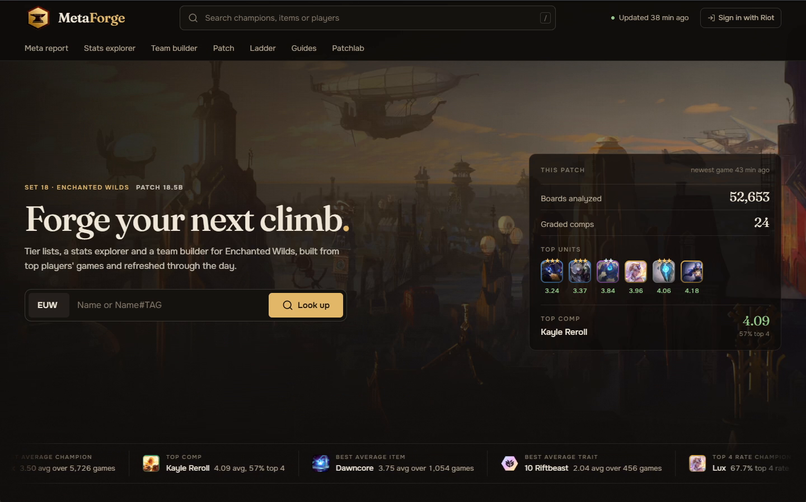
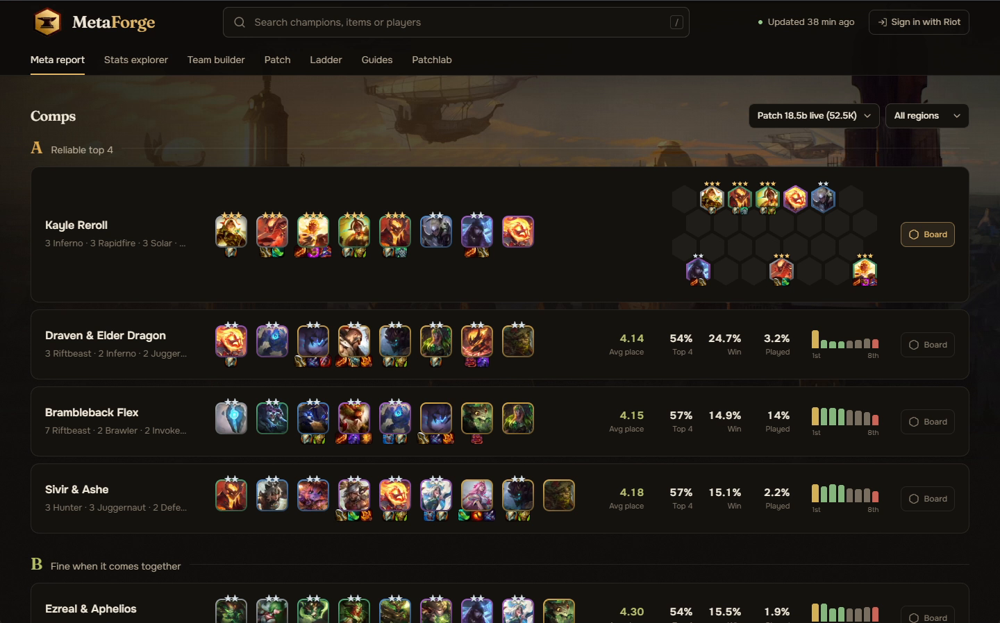
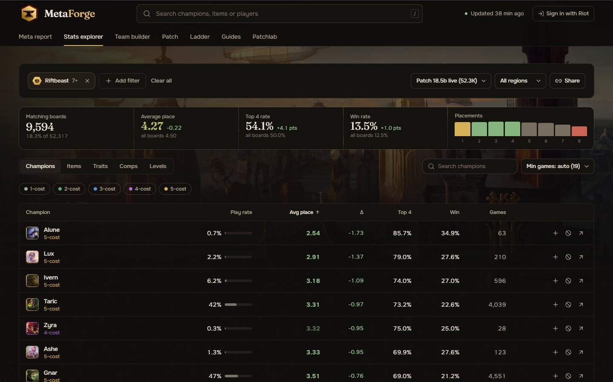
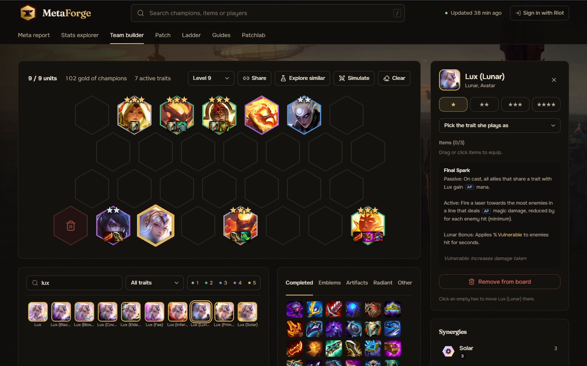

<div align="center">

# MetaForge

Teamfight Tactics tier lists, stats explorer and team builder.

[metaforge.lol](https://metaforge.lol) · Next.js · TypeScript · PostgreSQL

</div>

<table>
<tr>
<td align="center" width="50%"><br><sub>Home</sub></td>
<td align="center" width="50%"><br><sub>Meta report</sub></td>
</tr>
<tr>
<td align="center" width="50%"><br><sub>Stats explorer</sub></td>
<td align="center" width="50%"><br><sub>Team builder</sub></td>
</tr>
</table>

## What's in it

- **Meta report**: comps grouped by carry and graded for the live patch, with champion, item and trait tier lists
- **Stats explorer**: filter boards by champions, items, traits and level, and see how everything does on them
- **Team builder**: drag champions onto a board, add items and emblems, save it or share the link
- **Ladder and player lookup** for every region, **guides** and **patch notes**

Every stat comes from high-elo ranked games, collected through the Riot Games API.

## Run it

```bash
npm install
cp .env.example .env.local   # a Riot API key, and DATABASE_URL for a public site
npm run dev
```

Needs Node.js 20.9 or newer. Without `DATABASE_URL` matches are kept in `./.data`; every setting is
described in `.env.example`.

<sub>MetaForge isn't endorsed by Riot Games. Riot Games and all associated properties are trademarks of Riot Games, Inc. Game data by CommunityDragon.</sub>
